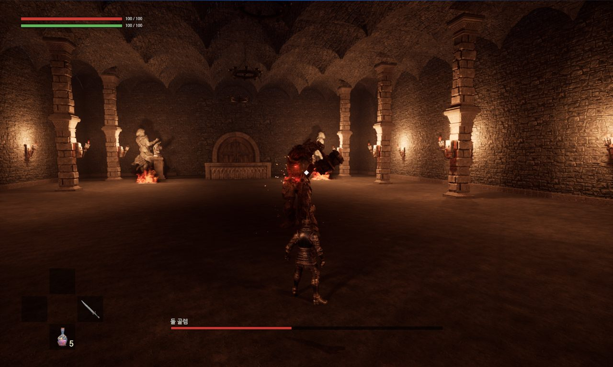
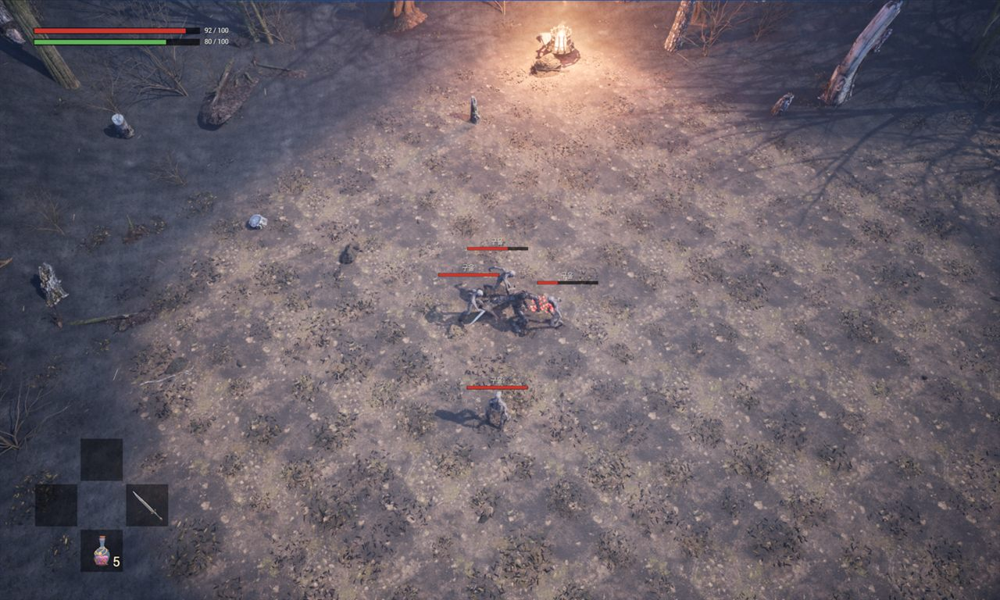
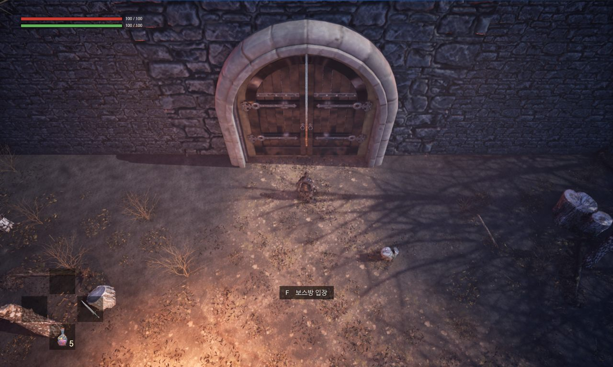
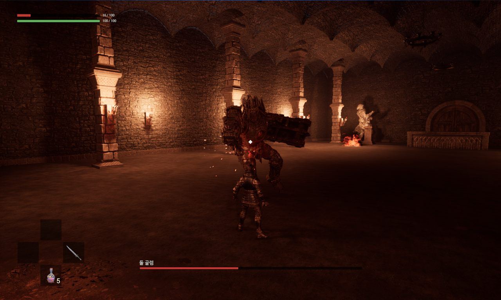
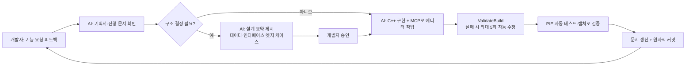

# OnlyDungeon

> **쿼터뷰 핵앤슬래시로 황폐한 숲을 헤쳐 나가다, 보스방 문을 여는 순간 3인칭 소울라이크 보스전으로 전환되는 다크 판타지 액션 게임**
>
> Unreal Engine 5.9 · C++ · Gameplay Ability System · StateTree · **AI 에이전트(Claude Code)와 함께 만든 풀 바이브 코딩 프로젝트**




---

## 1. 게임 소개

### 한 줄 요약
**필드에서는 쿼터뷰로 몰려드는 적을 베어 나가고, 보스방에 들어서면 컷신과 함께 카메라가 캐릭터 뒤로 내려와 1:1 소울라이크 보스전이 시작됩니다.** 두 전투 모드는 같은 모션과 같은 GAS 어빌리티를 공유하고, 카메라·입력·조준·판정 방식만 바뀝니다.

### 게임 흐름
```
시작 공터 ─▶ 숲길(구울 무리) ─▶ 무너진 사당(세이브) ─▶ 족장의 광장(정예: 역병의 족장)
        ─▶ 보스 문 앞(세이브) ─▶ 입장 컷신(쿼터뷰 → 3인칭) ─▶ 지하 보스 홀: 돌 골렘
                                                         ├─ 승리 → 던전 클리어, 제단 뒤 다음 지역 문 개방
                                                         └─ 사망 → 마지막 휴식 지점에서 부활, 적 초기화
```

### 스크린샷
| 필드: 쿼터뷰 핵앤슬래시 | 보스방 문 앞 |
|---|---|
|  |  |
| **필드**: 구울 무리와 싸우는 쿼터뷰 전투, 적 이름표·체력 바, 장비 칸 HUD | **보스방 문 앞**: 화톳불 세이브 지점과 보스방 입구. F를 누르면 입장 컷신이 시작됨 |

| 보스전: 3인칭 소울라이크 |
|---|
|  |
| **보스전**: 입장 컷신 뒤 3인칭으로 전환. 락온, 보스 체력 바, 거대한 망치를 휘두르는 돌 골렘 |

### 핵심 플레이
| 구분 | 필드 (쿼터뷰 핵앤슬래시) | 보스방 (3인칭 소울라이크) |
|---|---|---|
| 카메라 | 위에서 내려다보는 쿼터뷰 | 캐릭터 뒤 3인칭 + 락온 |
| 조준 | 마우스 커서 방향 | 락온 대상 / 카메라 정면 |
| 판정 | 범위 판정 (다수의 적) | 무기 궤적 스윕 판정 (1:1) |
| 액션 | 평타 콤보, 회피, 달리기, 물약 | + 강공격, 패링(한손검) / 가드(대검), 파생 콤보 |

- **무기 2종 실시간 교체 (Tab):** 한손검 ↔ 양손 대검. 등에 칼을 넣고 꺼내는 상체 모션 중 손이 닿는 순간 교체되며, 모션 세트·방어 방식·판정이 무기 데이터에 따라 통째로 바뀝니다.
- **회피:** 락온이 없으면 입력 방향으로 돌아 앞구르기, 락온 중에는 대상을 바라본 채 8방향 구르기. 무적 프레임과 공격 후딜 캔슬 지원.
- **강인도(Poise)·경직:** 공격마다 강인도 피해가 쌓이면 경직, 무거운 공격은 큰 경직.
- **적 AI:** 데이터로 정의한 패턴(거리·가중치·쿨타임·필요 태그)으로 싸우고, 간 보기(옆걸음)·빈틈 공략·무리 어그로·공격 순번·순찰·매복·귀환 회복을 합니다.

### 등장 적
| 적 | 특징 |
|---|---|
| 구울 | 무리 지어 순찰·매복, 한 명이 발견하면 주변이 함께 달려옴. 공격 순번으로 한꺼번에 덤비지 않음 |
| 저주받은 사냥꾼 | 도약 공격으로 거리를 좁히는 중형 몬스터 |
| 역병의 족장 (정예) | 돌진·도약 내려찍기·4연타, 길목의 1:1 관문 |
| **돌 골렘 (보스)** | 6개 근접 패턴 + 회전 돌진. 체력 절반에서 2페이즈 진입: 몸 중심의 불꽃이 차징되며 커지다 플레이어 위치로 **포물선 화염구**를 발사(패링 불가 범위 피해) |

### 연출과 완성도
- 타격 정지(히트스톱), 피격·타격 카메라 흔들림, 무기 궤적(플레이어는 푸른빛, 적은 붉은빛), 바닥 피, 시체가 먼지와 함께 가라앉는 정리 연출
- 저체력 비네트, 차가운 그림자 톤과 필름 그레인 후처리
- 필드·보스 배경음 전환, 환경음, 재질별 발소리, 무기·피격 효과음
- 타이틀 / 일시정지(볼륨 3종) / 던전 클리어(플레이 시간·사망 횟수) 화면, `USaveGame` 자동 저장·이어하기
- PCG로 자동 배치한 약 26,000개 인스턴스의 숲, 42×54m 지하 보스 홀

---

## 2. 사용한 Unreal Engine 기술

### 아키텍처 한눈에 보기
```
UI (HUD·타이틀·일시정지·클리어 위젯) ──델리게이트 구독──┐
                                                       ▼
Character / AbilitySystem / AI / Equipment / World  ──▶  Core (태그·로그·서브시스템·게임 모드)
```
- 의존성은 `UI → 게임플레이 → Core` 한 방향만 허용합니다. 게임플레이 코드는 UI 헤더를 모르고, UI는 Attribute 변경 델리게이트·GameplayCue·GameplayEvent를 스스로 구독합니다.
- 상속 트리 대신 **ActorComponent + 인터페이스 조합**: 락온, 장비, 전투 모드, 상호작용, 물약, 적 전투 패턴이 각각 독립 컴포넌트입니다.

### Gameplay Ability System (전투의 핵심)
| 요소 | 구현 |
|---|---|
| 어빌리티 | 근접 콤보(파생 콤보 분기), 방어(패링·가드), 회피, 달리기, 물약, 휴식, 무기 교체, 피격, 사망, 포효, 스태미나 회복, **차징 투사체**까지 12종 C++ 어빌리티 |
| Attribute | `Health`(체력·피해 메타) / `Combat`(스태미나·회복 속도·강인도·공격력·방어력·무게) 세트, 모든 변경은 GameplayEffect로만 |
| 데미지 | 메타 Attribute + `UODDamageExecution`(ExecutionCalculation): 방어력, 정면 판정, 패링·가드 감소, 강인도, 패링 불가 태그 처리 |
| 입력 | Enhanced Input → **InputTag**로 어빌리티 연결 (키가 아니라 태그에 바인딩) |
| 상태 | bool 대신 Gameplay Tag(`State.Attacking`, `State.Stunned`, `State.Phase.2` …), Native Gameplay Tag 65개를 한곳에서 정의 |
| 애니메이션 연동 | AnimNotifyState → `SendGameplayEventToActor` / `WaitGameplayEvent`로 판정·콤보 입력 구간 처리 |
| 연출 | GameplayCue로 피격 이펙트·사운드·바닥 피 |

### 그 밖의 엔진 기능
- **StateTree AI:** 커스텀 태스크 6종·조건 5종(패턴 실행, 추격, 간 보기, 대기 행동, 귀환, 사거리·빈틈 판정 …) + 전투 패턴 `DataAsset`
- **서브시스템:** 필드(적 등록·공격 순번·무리 알림), 보스전 상태, 저장, 오디오 디렉터를 `World/GameInstanceSubsystem`으로 분리
- **Enhanced Input**, **Level Sequence 입장 컷신**(진입 지점 기준 Transform Origin), **Niagara**(User 파라미터로 크기·색 제어), **PCG**(숲·소품 자동 배치), **Geometry Script**, **IK Retargeter**(Paragon·Mixamo·Fab 모션 → Manny), **런타임 포즈 리타깃**(Manny가 돌리는 모든 애니메이션을 기사 메시에 실시간으로 옮겨 입힘)
- **에디터 전용 모듈 `OnlyDungeonEditor`:** 몽타주 구간 편집, StateTree 구성, 사운드큐 생성, 시퀀스 카메라 설정을 Python에서 호출하는 C++ 라이브러리

### 성능·안정성 원칙
- 새 Actor/Component는 **Tick 기본 꺼짐**, 필요한 동안만 타이머(이름 있는 상수 주기)로 갱신
- Hot Path에서 힙 할당 금지(스크래치 버퍼 `Reset()` 재사용, `TInlineAllocator`), 매 프레임 `FindComponentByClass`·`GetAllActorsOfClass` 금지 → 서브시스템 등록·캐시
- `TObjectPtr`/`TWeakObjectPtr`/`IsValid()` 규칙, 타이머·델리게이트 콜백은 `CreateWeakLambda`로 수명 안전
- 사망·피격으로 어빌리티가 끊겨도 `EndAbility`의 취소 경로에서 타이머·이동 설정·부여 태그를 모두 원상복구
- Shipping 빌드에서는 테스트 입력(F5·F6)과 디버그 HUD를 컴파일 단계에서 제외
- 결과: 패키지 빌드 평균 **약 178fps**(1600×900, 게임 스레드 3.3ms·GPU 4.0ms, 시작 지점 측정)

---

## 3. AI 풀 바이브 코딩: 어떻게 만들었나

> **C++ 코드 약 19,000줄(템플릿 제외), 커밋 106개, 개발 기간 2주(2026-11-13 ~ 11-26).**
> 모든 C++ 코드 작성과 에디터 작업(에셋 생성, 리타깃, 레벨 구성, 테스트)은 **AI 에이전트 Claude Code**가 수행했습니다.
> 개발자는 **기획 결정, 설계 승인, 플레이 피드백**에 집중했습니다.

단순히 "코드를 생성해 달라"고 요청하는 방식이 아닙니다. AI가 **엔진 에디터를 직접 조작하고, 스스로 빌드·테스트·검증까지 하는 개발 파이프라인**을 구성했습니다. 핵심은 아래 다섯 가지입니다.

### ① 규칙 문서로 AI의 판단 기준을 고정 — [`CLAUDE.md`](CLAUDE.md)
AI는 대화마다 맥락을 잃습니다. 그래서 프로젝트의 "헌법"을 문서로 만들어, 모든 세션이 같은 기준으로 일하게 했습니다.
- **설계 승인 게이트(Human-in-the-Loop):** GAS 구조, 컴포넌트 배치, 데이터 스키마 같은 아키텍처 결정은 AI가 임의로 구현하지 않습니다. 먼저 *데이터 레이아웃 → 인터페이스 초안 → 성능 병목·엣지 케이스 대응*을 요약해 승인을 받은 뒤에 구현합니다.
- **엔진 표준 + 프로젝트 규칙:** `OD` 접두사 네이밍, `TObjectPtr`·`IsValid` 규칙, Tick 금지 원칙, Hot Path 할당 금지, 의존성 방향, 반드시 처리할 엣지 케이스(시전 중 사망, 중복 실행, 무효 대상, 수명 정리)
- **"존재하지 않는 API 추측 금지":** 확실하지 않은 엔진 API는 엔진 소스에서 시그니처를 확인한 뒤에만 쓰게 해서 환각 코드를 차단했습니다.
- **반복된 실수를 규칙으로 승격:** 예를 들어 "캐릭터 발이 땅에 붙은 채 미끄러지는" 문제가 세 번 반복되자, 원인 5가지와 측정 방법을 규칙(11장)으로 만들어 이후 모든 캐릭터 작업에서 자동으로 점검하게 했습니다.

### ② 문서 기반 장기 기억 — [`Docs/GameDesign.md`](Docs/GameDesign.md)
- **기획서:** 모든 기획 결정의 기준입니다. 문서에 없거나 "미정"인 항목은 AI가 정하지 않고 사람에게 묻습니다. 기획 변경은 승인 후에만 반영합니다.
- **진행 문서(로컬):** 완료한 작업, 생성한 클래스·에셋, PIE 검증 수치, 엔진 노하우("이 API는 Python에서 막혀 있으니 import_text로 우회" 등)를 기록합니다. 새 세션은 이 문서를 먼저 읽고 바로 이어서 작업합니다.

### ③ AI가 에디터를 직접 조작 — Unreal MCP + Python
- UE 5.9 에디터 내장 **MCP 서버**에 AI를 연결해 액터 배치, 블루프린트·에셋 생성, 레벨 편집을 직접 수행했습니다. 데스크톱 앱에서도 쓸 수 있도록 프로토콜 변환 브리지([`Tools/MCP/od-mcp-bridge.mjs`](Tools/MCP/od-mcp-bridge.mjs))를 직접 작성했습니다.
- 반복 작업은 **재현 가능한 Python 스크립트**로 남겼습니다.
  - [`Tools/DungeonMap/`](Tools/DungeonMap): 지형·나무·PCG·조명·게임플레이 배치를 코드로 생성
  - [`Tools/StateTree/`](Tools/StateTree): StateTree를 스펙(dict)으로 선언해 통째로 빌드
  - [`Tools/UI/`](Tools/UI): 3D 메시를 촬영해 HUD 아이콘 텍스처 자동 생성
  - [`Tools/Animation/`](Tools/Animation): 무기 교체 몽타주 구성
- **에디터 작업도 승인 후 실행:** 목적·대상 경로·변경 항목·복구 가능 여부를 먼저 제시합니다. Git에 없는 `Content/` 에셋의 삭제·덮어쓰기는 "복구 불가"를 명시합니다.

### ④ 자동 빌드 검증 루프 — [`ValidateBuild.bat`](ValidateBuild.bat), [`Tools/Build/`](Tools/Build)
- C++을 고친 뒤에는 반드시 스크립트로 컴파일을 확인하고 나서 보고·커밋합니다. 종료 코드로 상황을 구분합니다: `0` 성공, `1` 컴파일 에러, `2` 환경 문제, `3` Live Coding 충돌.
- 에러가 나면 **첫 번째 에러부터 분석 → 수정 → 재빌드를 최대 5회** 반복하고, 해결되지 않으면 멈추고 보고합니다. 빌드를 통과시키려고 기능을 지우거나 경고를 끄는 것은 금지했습니다.
- 에디터를 켠 채 게임 타겟·Shipping을 컴파일하는 스크립트, 에디터를 껐다 다시 빌드·재실행하는 스크립트, Shipping 패키징 스크립트까지 자동화했습니다.

### ⑤ AI가 직접 플레이 테스트 — PIE 자동 QA
"코드가 컴파일된다"에서 멈추지 않고, AI가 **PIE(에디터 플레이)를 직접 돌려 결과를 수치로 확인**한 뒤에 완료를 보고했습니다.
- Python으로 PIE를 시작하고 입력·피해·이동을 주입한 뒤, 로그 프로브로 체력·태그·어빌리티 상태를 측정합니다.
  > 예: "물약 회복이 60이 아니라 52.5" → 저프레임에서 마지막 회복 틱과 몽타주 종료가 한 프레임에 겹치는 원인을 찾아 수정
- 내비게이션 경로 검사, 캡슐 스윕으로 문 통과 확인, 오프스크린 **씬 캡처**로 연출을 눈으로 확인
- [`Tools/AnimCheck/od_foot_check.py`](Tools/AnimCheck/od_foot_check.py): 보폭과 slip(디딤 발 속도 ÷ 몸 속도)을 측정해 발 미끄러짐을 수치로 검증

### 개발 흐름


### 운영 규칙
- **Git은 소스 전용:** `Source/`, `Config/`, 문서, 도구만 추적합니다. 바이너리 에셋(`Content/`)은 추적하지 않습니다.
- **브랜치:** `dev`에서 개발하고, 빌드·플레이 테스트 후 사람이 지시할 때만 `main`에 `--no-ff`로 병합합니다.
- **커밋:** `Feat/Fix/Refactor/Chore/Docs` 접두사를 붙이고, 한 커밋에 한 기능만 담습니다.
  - 106개 커밋 구성: Feat 56 · Docs 21 · Chore 12 · Fix 9 · Refactor 8

---

## 4. 저장소 구조
```
Source/OnlyDungeon/
├── Core/           게임 모드, Native Gameplay Tag, 로그 채널, 서브시스템(필드·보스전·저장·오디오)
├── AbilitySystem/  ASC, AttributeSet, 어빌리티 12종, 데미지 Execution, GameplayCue, 투사체
├── Character/      플레이어·적 캐릭터, 락온·전투 모드·물약·적 전투 패턴 컴포넌트
├── AI/             AIController, StateTree 노드, 전투 패턴 DataAsset
├── Equipment/      무기 데이터(DataAsset)·무기 액터·장비 컴포넌트
├── Animation/      AnimInstance, 판정·이벤트 AnimNotifyState
├── World/          보스방 입구·다음 지역 문·리스폰 포인트·훈련용 허수아비
├── Interaction/    상호작용 인터페이스·컴포넌트
├── UI/             HUD·타이틀·일시정지·클리어·적 이름표 위젯
└── Variant_*/      UE 템플릿 코드 (참고용, 사용하지 않음)
Source/OnlyDungeonEditor/   에디터 전용 Python 노출 라이브러리
Tools/                      에디터 자동화 스크립트, 빌드·패키징, MCP 브리지
Docs/GameDesign.md          기획서
CLAUDE.md                   AI 작업 규칙
```

## 5. 빌드 방법
> 이 저장소에는 코드만 있고 에셋(`Content/`)은 포함되어 있지 않습니다. 사용한 Fab·마켓플레이스 에셋은 각 판매자의 라이선스를 따르므로 재배포하지 않습니다.

1. Unreal Engine **5.9**와 Visual Studio 2022(C++ 게임 개발 워크로드)를 설치합니다.
2. 에디터 빌드: `ValidateBuild.bat`
3. Shipping 패키징: `Tools\Build\PackageGame.bat` → 결과는 `Saved\Package\Shipping\Windows\OnlyDungeon.exe`

### 조작
| 행동 | 키 |
|---|---|
| 이동 / 시점 | WASD / 마우스 |
| 약공격 / 강공격 | 좌클릭 / 우클릭 |
| 방어(패링·가드) | Left Shift |
| 회피 / 달리기 | Space / Space 계속 누르기 |
| 락온 | 마우스 휠 클릭 |
| 물약 / 상호작용 / 무기 교체 | R / F / Tab |
| 일시정지 | Esc |
